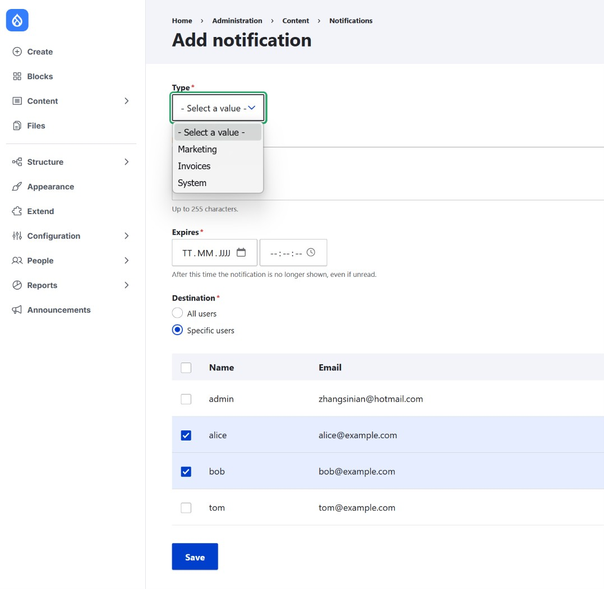
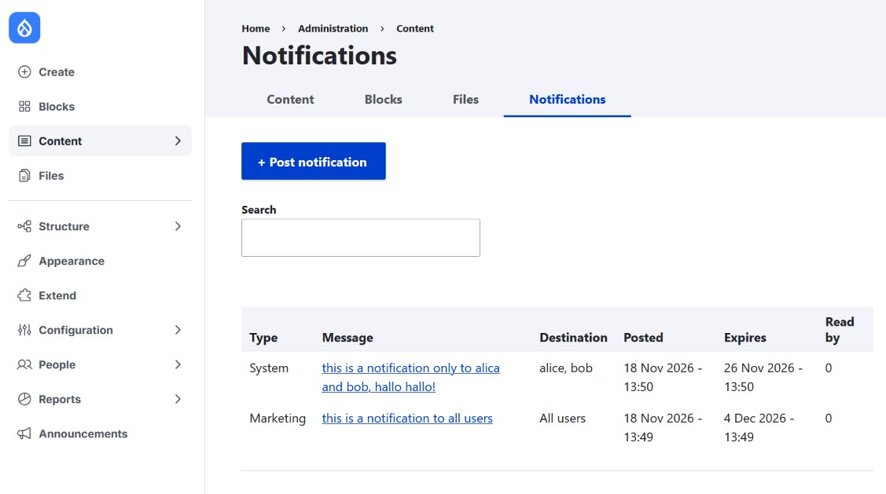
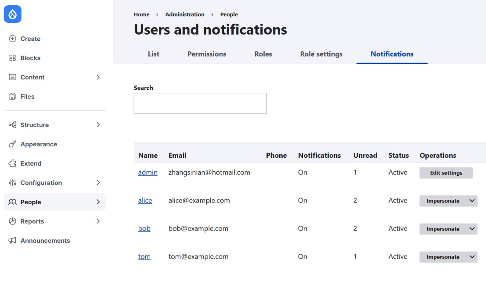
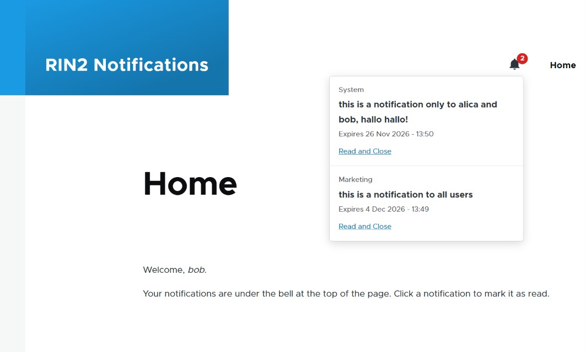
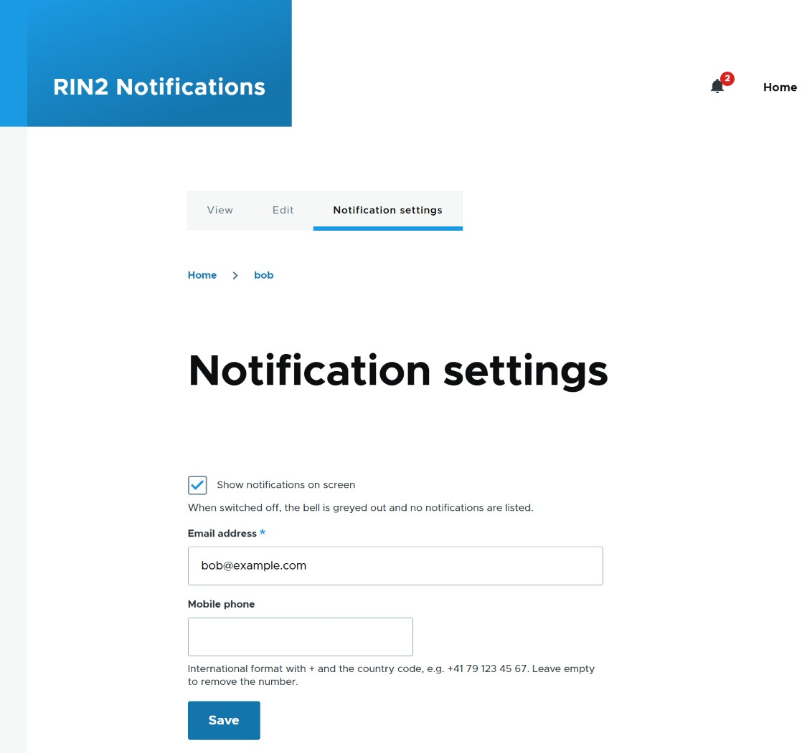

# RIN2 – Web app with Notifications (Drupal 11)

Requirements: [Web app with Notifications.pdf](requirements/Web%20app%20with%20Notifications.pdf)

The requirements were written for a Laravel project. This project builds the same features in Drupal 11.

All custom code is in one module: `web/modules/custom/rin2_notify`.

Stack: Drupal 11.4, PHP 8.4, MariaDB 11.8, run with DDEV.

## Install

Prerequisites: [DDEV](https://ddev.com) and Docker.

```bash
ddev start
ddev composer install
ddev drush site:install --existing-config --account-name=admin -y
ddev drush user:create alice --mail=alice@example.com --password=alice
ddev drush user:create bob --mail=bob@example.com --password=bob
ddev drush uli          # login link for admin
```

The site runs at https://my-drupal11-site.ddev.site.

## Features

| Spec | Where |
|---|---|
| Users table: notification switch (NOT NULL) + phone (nullable) | User base fields, update hooks `11001`/`11002`, see `rin2_notify/docs/users-migration.md` |
| Post a notification (type, text, expiry, all users or specific users) | Content → Post notification (`/admin/content/notifications/add`) |
| Posted notifications with detail page + filters | `/admin/content/notifications` |
| Users with unread count + filters, impersonate | People → Notifications (`/admin/people/notifications`) |
| Home page with bell, unread counter, click to mark read | `/home` (front page); the bell is in the header of every page |
| Notification settings (on/off, email, phone) | `/user/{uid}/notification-settings`, linked from `/home` |

## Screenshots

**Post a notification**



**Posted notifications**



**Users with unread count**



**Home page with bell**



**Notification settings**



## Try it

1. As admin, post one notification for all users and one for alice.
2. People → Notifications: alice has 2 unread, bob 1. Click **Impersonate** on alice.
3. On `/home` the bell shows 2. Open it and click **Read and Close**: the counter goes down.
4. Open **Notification settings**, enter a mobile number like `+41 79 123 45 67` (saved as `+41791234567`). A landline or a number without `+` is rejected.
5. Switch notifications off: the bell turns grey. Return to admin with **Unmasquerade** in the account menu.

## Notes

- **Phone validation** uses `giggsey/libphonenumber-for-php`: free, works offline, needs no API key. Numbers must be in international format (`+` and country code) and be mobile numbers. The check is formal: it doesn't verify that the number is in use (that would need an SMS code).
- **Notifications can't be edited or deleted** once posted.
- **Users with notifications off** have a grey bell and count 0 unread.

